# Feature tree map

> Generated by `python scripts/feature_tree_map.py --write`. Do not edit by hand.
> Interactive version: https://jonathango98.github.io/nextgen27-sidequest/

Every planned piece of work and what it needs first (ENG-105 to ENG-108). Pieces flow left to right: finishing one unlocks the pieces it points to. Run `/pick-task` to claim one.

**Working** 5 · **In progress** 0 · **Ready** 7 · **Waiting** 47 · **Needs decision** 20

Colors: green Working, blue In progress, gold Ready, gray Waiting, red dashed Needs decision.

```mermaid
flowchart LR
  subgraph built [Already working]
    app_foundation["app.foundation"]
    infra_hosting["infra.hosting"]
    auth_join_login["auth.join-login"]
    code_my_code["code.my-code"]
    screens_skeleton["screens.skeleton"]
  end
  subgraph f_staff ["Staff accounts and roles"]
    staff_accounts["staff.accounts<br/>M · hard"]
    staff_login["staff.login<br/>M · hard"]
    staff_manage["staff.manage<br/>S · medium"]
    staff_screen_mode["staff.screen-mode<br/>S · medium"]
  end
  subgraph f_game_state ["Game states and pause"]
    game_state_core["game-state.core<br/>M · medium"]
    game_state_banner["game-state.banner<br/>S · easy"]
    game_state_admin_switch["game-state.admin-switch<br/>S · medium"]
  end
  subgraph f_points ["Points service"]
    points_audit_log["points.audit-log<br/>S · medium"]
    points_ledger["points.ledger<br/>M · hard"]
    points_score_bar["points.score-bar<br/>S · easy"]
    points_join["points.join<br/>S · medium"]
  end
  subgraph f_connections ["Scanner and connections, with icebreaker"]
    connections_table["connections.table<br/>S · medium"]
    connections_scanner_camera["connections.scanner-camera<br/>M · medium"]
    connections_scan_save["connections.scan-save<br/>M · hard"]
    connections_incoming["connections.incoming<br/>S · medium"]
    connections_points["connections.points<br/>M · hard"]
    connections_icebreaker_question["connections.icebreaker-question<br/>S · medium"]
    connections_icebreaker_answer["connections.icebreaker-answer<br/>M · hard"]
  end
  subgraph f_look ["Mix look on player screens"]
    look_frame["look.frame<br/>M · easy"]
    look_components["look.components<br/>S · easy"]
    look_home["look.home<br/>S · easy"]
    look_code["look.code<br/>S · easy"]
    look_summary["look.summary<br/>S · easy"]
  end
  subgraph f_home ["Home and Quests pages"]
    home_progress["home.progress<br/>S · easy"]
    home_quests["home.quests<br/>S · easy"]
  end
  subgraph f_checkin ["Session check-in"]
    checkin_sessions["checkin.sessions<br/>M · medium"]
    checkin_end_session["checkin.end-session<br/>S · medium"]
    checkin_hall_code["checkin.hall-code<br/>S · medium"]
    checkin_scan["checkin.scan<br/>M · hard"]
    checkin_close["checkin.close<br/>S · easy"]
  end
  subgraph f_explore ["Explore"]
    explore_places["explore.places<br/>M · medium"]
    explore_booth["explore.booth<br/>S · medium"]
    explore_hidden_item["explore.hidden-item<br/>S · medium"]
    explore_photobooth["explore.photobooth<br/>S · medium"]
  end
  subgraph f_journal ["Journal and Summary page"]
    journal_table["journal.table<br/>S · medium"]
    journal_write["journal.write<br/>M · medium"]
    journal_list["journal.list<br/>S · easy"]
    journal_sharing["journal.sharing<br/>S · medium"]
    journal_review["journal.review<br/>M · hard"]
    journal_summary["journal.summary<br/>S · medium"]
  end
  subgraph f_stickers ["Stickers (Open Box)"]
    stickers_math["stickers.math<br/>S · easy"]
    stickers_open_box["stickers.open-box<br/>S · easy"]
    stickers_claim["stickers.claim<br/>M · medium"]
    stickers_stock["stickers.stock<br/>S · medium"]
  end
  subgraph f_leaderboards ["Leaderboards and church score"]
    leaderboards_players["leaderboards.players<br/>M · medium"]
    leaderboards_churches["leaderboards.churches<br/>M · medium"]
    leaderboards_in_app["leaderboards.in-app<br/>S · medium"]
  end
  subgraph f_usher ["Usher console"]
    usher_scan["usher.scan<br/>M · medium"]
    usher_player_lookup["usher.player-lookup<br/>S · medium"]
  end
  subgraph f_admin ["Admin console"]
    admin_players["admin.players<br/>S · medium"]
    admin_pin_reset["admin.pin-reset<br/>S · medium"]
    admin_fix_church["admin.fix-church<br/>S · easy"]
    admin_award_revoke["admin.award-revoke<br/>M · hard"]
    admin_churches["admin.churches<br/>S · medium"]
    admin_audit_view["admin.audit-view<br/>M · medium"]
  end
  subgraph f_screen ["Main screen views (leaderboards, takeaway wall, check-in QR, paused)"]
    screen_shell["screen.shell<br/>M · medium"]
    screen_refresh["screen.refresh<br/>S · medium"]
    screen_takeaway_wall["screen.takeaway-wall<br/>S · medium"]
  end
  subgraph f_wrapped ["Wrapped cards"]
    wrapped_unlock["wrapped.unlock<br/>S · medium"]
    wrapped_cards["wrapped.cards<br/>M · medium"]
    wrapped_people["wrapped.people<br/>S · medium"]
    wrapped_regions["wrapped.regions<br/>S · medium"]
    wrapped_collection["wrapped.collection<br/>M · hard"]
    wrapped_journal["wrapped.journal<br/>S · medium"]
    wrapped_play_style["wrapped.play-style<br/>S · medium"]
    wrapped_together["wrapped.together<br/>S · medium"]
    wrapped_save_image["wrapped.save-image<br/>M · hard"]
  end
  subgraph f_recap ["Conference recap screen"]
    recap_totals["recap.totals<br/>S · medium"]
    recap_verse["recap.verse<br/>S · medium"]
  end
  subgraph f_ready ["Game day readiness (log out, rate limits, backups, load test, data cleanup)"]
    ready_logout["ready.logout<br/>S · easy"]
    ready_rate_limits["ready.rate-limits<br/>M · hard"]
    ready_backups["ready.backups<br/>M · hard"]
    ready_load_test["ready.load-test<br/>M · hard"]
    ready_retention["ready.retention<br/>M · hard"]
  end
  app_foundation --> staff_accounts
  staff_accounts --> staff_login
  staff_login --> staff_manage
  points_audit_log --> staff_manage
  staff_login --> staff_screen_mode
  app_foundation --> game_state_core
  game_state_core --> game_state_banner
  game_state_core --> game_state_admin_switch
  staff_login --> game_state_admin_switch
  points_audit_log --> game_state_admin_switch
  app_foundation --> points_audit_log
  points_audit_log --> points_ledger
  game_state_core --> points_ledger
  points_ledger --> points_score_bar
  points_ledger --> points_join
  app_foundation --> connections_table
  screens_skeleton --> connections_scanner_camera
  connections_table --> connections_scan_save
  connections_scanner_camera --> connections_scan_save
  code_my_code --> connections_scan_save
  connections_scan_save --> connections_incoming
  connections_scan_save --> connections_points
  points_ledger --> connections_points
  connections_scan_save --> connections_icebreaker_question
  connections_icebreaker_question --> connections_icebreaker_answer
  screens_skeleton --> look_frame
  look_frame --> look_components
  look_components --> look_home
  look_components --> look_code
  look_components --> look_summary
  points_ledger --> home_progress
  stickers_math --> home_progress
  points_ledger --> home_quests
  staff_login --> checkin_sessions
  points_audit_log --> checkin_sessions
  checkin_sessions --> checkin_end_session
  game_state_admin_switch --> checkin_end_session
  checkin_sessions --> checkin_hall_code
  screen_shell --> checkin_hall_code
  code_my_code --> checkin_hall_code
  checkin_hall_code --> checkin_scan
  connections_scanner_camera --> checkin_scan
  points_ledger --> checkin_scan
  checkin_end_session --> checkin_close
  checkin_sessions --> journal_table
  journal_table --> journal_write
  points_ledger --> journal_write
  checkin_end_session --> journal_write
  journal_write --> journal_list
  journal_write --> journal_sharing
  journal_sharing --> journal_review
  staff_login --> journal_review
  points_audit_log --> journal_review
  journal_review --> journal_summary
  staff_login --> explore_places
  points_audit_log --> explore_places
  usher_scan --> explore_booth
  explore_places --> explore_booth
  points_ledger --> explore_booth
  usher_scan --> explore_hidden_item
  explore_places --> explore_hidden_item
  points_ledger --> explore_hidden_item
  usher_scan --> explore_photobooth
  points_ledger --> explore_photobooth
  staff_login --> usher_scan
  connections_scanner_camera --> usher_scan
  code_my_code --> usher_scan
  usher_scan --> usher_player_lookup
  points_ledger --> stickers_math
  stickers_math --> stickers_open_box
  usher_scan --> stickers_claim
  stickers_math --> stickers_claim
  game_state_core --> stickers_claim
  stickers_claim --> stickers_stock
  points_ledger --> leaderboards_players
  screen_shell --> leaderboards_players
  points_ledger --> leaderboards_churches
  screen_shell --> leaderboards_churches
  leaderboards_players --> leaderboards_in_app
  staff_login --> admin_players
  admin_players --> admin_pin_reset
  points_audit_log --> admin_pin_reset
  admin_players --> admin_fix_church
  points_audit_log --> admin_fix_church
  admin_players --> admin_award_revoke
  points_ledger --> admin_award_revoke
  staff_login --> admin_churches
  points_audit_log --> admin_churches
  staff_login --> admin_audit_view
  points_audit_log --> admin_audit_view
  connections_scan_save --> admin_audit_view
  staff_screen_mode --> screen_shell
  game_state_core --> screen_shell
  screen_shell --> screen_refresh
  screen_shell --> screen_takeaway_wall
  journal_review --> screen_takeaway_wall
  game_state_core --> wrapped_unlock
  staff_login --> wrapped_unlock
  points_audit_log --> wrapped_unlock
  wrapped_unlock --> wrapped_cards
  look_components --> wrapped_cards
  wrapped_cards --> wrapped_people
  connections_scan_save --> wrapped_people
  wrapped_people --> wrapped_regions
  wrapped_cards --> wrapped_collection
  connections_icebreaker_answer --> wrapped_collection
  wrapped_cards --> wrapped_journal
  journal_write --> wrapped_journal
  wrapped_cards --> wrapped_play_style
  stickers_math --> wrapped_play_style
  wrapped_cards --> wrapped_together
  connections_scan_save --> wrapped_together
  wrapped_cards --> wrapped_save_image
  screen_shell --> recap_totals
  connections_scan_save --> recap_totals
  journal_review --> recap_totals
  recap_totals --> recap_verse
  connections_icebreaker_answer --> recap_verse
  auth_join_login --> ready_logout
  auth_join_login --> ready_rate_limits
  app_foundation --> ready_backups
  auth_join_login --> ready_load_test
  points_audit_log --> ready_retention
  classDef working fill:#e6f2e9,stroke:#1e7b3a,color:#14151a
  classDef in_progress fill:#e8eefc,stroke:#1f4fd1,color:#14151a
  classDef ready fill:#fff4d6,stroke:#a87400,stroke-width:3px,color:#14151a
  classDef waiting fill:#f1f0eb,stroke:#c3c0b6,color:#545a66
  classDef decision fill:#fdeeec,stroke:#b42318,stroke-dasharray:4 3,color:#14151a
  class app_foundation,auth_join_login,code_my_code,infra_hosting,screens_skeleton working
  class connections_scanner_camera,connections_table,game_state_core,look_frame,points_audit_log,ready_logout,staff_accounts ready
  class admin_audit_view,admin_award_revoke,admin_churches,admin_fix_church,admin_pin_reset,admin_players,checkin_close,checkin_end_session,checkin_hall_code,checkin_scan,checkin_sessions,connections_incoming,connections_scan_save,explore_booth,explore_hidden_item,explore_places,game_state_admin_switch,game_state_banner,home_progress,home_quests,journal_list,journal_review,journal_sharing,journal_summary,journal_table,journal_write,look_code,look_components,look_home,look_summary,points_ledger,points_score_bar,recap_totals,screen_shell,screen_takeaway_wall,staff_login,staff_manage,staff_screen_mode,stickers_claim,stickers_math,stickers_open_box,usher_player_lookup,usher_scan,wrapped_cards,wrapped_journal,wrapped_people,wrapped_unlock waiting
  class connections_icebreaker_answer,connections_icebreaker_question,connections_points,explore_photobooth,leaderboards_churches,leaderboards_in_app,leaderboards_players,points_join,ready_backups,ready_load_test,ready_rate_limits,ready_retention,recap_verse,screen_refresh,stickers_stock,wrapped_collection,wrapped_play_style,wrapped_regions,wrapped_save_image,wrapped_together decision
```

## Ready now

- `staff.accounts`: StaffAccount table, password hashing, and a server command that creates the first admin from an environment variable (M, hard, backend)
- `game-state.core`: GameState table with one row (on, paused, off), a read helper, and 423 PAUSED or GAME_OFF refusals (M, medium, backend)
- `points.audit-log`: AuditLog table and one helper that writes an audit row, never updated or deleted (S, medium, backend)
- `connections.table`: Connection and ChurchMet tables in their own migration PR (S, medium, backend)
- `connections.scanner-camera`: The Scan page opens the camera and reads QR codes with barcode-detector served from our own server (M, medium, player-app)
- `look.frame`: The shared player frame in the Mix look, with top score bar, bottom bar, bloom streaks, and film grain (M, easy, design)
- `ready.logout`: POST /logout ends the player's session on this phone (S, easy, backend)

## In progress

- None

## Needs a decision

- `points.join`: GAME-044 (Game director)
- `connections.points`: GAME-016 (Game director)
- `connections.icebreaker-question`: GAME-019 (Game director)
- `connections.icebreaker-answer`: GAME-015 (Game director); GAME-019 (Game director)
- `explore.photobooth`: GAME-105 (Organizers)
- `stickers.stock`: GAME-069 (Game director)
- `leaderboards.players`: GAME-083 (Designer, game director); GAME-084 (Game director); GAME-088 (Game director, safety reviewer)
- `leaderboards.churches`: GAME-089 (Game director); GAME-082 (Game director)
- `leaderboards.in-app`: GAME-085 (Game director)
- `screen.refresh`: API-031 (Developers)
- `wrapped.regions`: WRAP-011 (Jonathan); DATA-010 (Jonathan, game director)
- `wrapped.collection`: WRAP-012 (Game director, developers)
- `wrapped.play-style`: WRAP-017 (Game director)
- `wrapped.together`: GAME-089 (Game director)
- `wrapped.save-image`: WRAP-033 (Developers)
- `recap.verse`: WRAP-012 (Game director, developers)
- `ready.rate-limits`: ARCH-031 (Developers, safety reviewer)
- `ready.backups`: ARCH-053 (Developers)
- `ready.load-test`: ARCH-072 (Developers)
- `ready.retention`: SAFE-014 (Leadership)
