# Feature tree map

> Generated by `python scripts/feature_tree_map.py --write`. Do not edit by hand.
> Interactive version: https://jonathango98.github.io/nextgen27-sidequest/

Every planned piece of work and what it needs first (ENG-105 to ENG-108), grouped by the week it is due (PRD-054). Pieces flow left to right in time: finishing one unlocks the pieces it points to. Run `/pick-task` to claim one.

**Working** 29 · **In progress** 0 · **Ready** 11 · **Waiting** 10 · **Needs decision** 0

Colors: green Working, blue In progress, gold Ready, gray Waiting, red dashed Needs decision.

```mermaid
flowchart LR
  subgraph built [Already working]
    app_foundation["app.foundation"]
    infra_hosting["infra.hosting"]
    auth_join_login["auth.join-login"]
    code_my_code["code.my-code"]
    screens_skeleton["screens.skeleton"]
  end
  subgraph w_2026_11_20 ["Due Fri Nov 20"]
    staff_accounts["staff.accounts<br/>M · hard"]
    staff_login["staff.login<br/>M · hard"]
    game_state_core["game-state.core<br/>M · medium"]
    points_audit_log["points.audit-log<br/>S · medium"]
    points_ledger["points.ledger<br/>M · hard"]
    points_score["points.score<br/>M · medium"]
  end
  subgraph w_2026_11_27 ["Due Fri Nov 27"]
    look_base["look.base<br/>L · easy"]
    look_screens["look.screens<br/>L · easy"]
  end
  subgraph w_2026_12_04 ["Due Fri Dec 4"]
    game_state_controls["game-state.controls<br/>M · medium"]
    game_state_auto_pause["game-state.auto-pause<br/>M · medium"]
    connections_table["connections.table<br/>S · medium"]
    connections_scanner_camera["connections.scanner-camera<br/>M · medium"]
    connections_meet["connections.meet<br/>L · hard"]
    connections_answers["connections.answers<br/>L · hard"]
    connections_verse_picker["connections.verse-picker<br/>S · medium"]
    checkin_sessions["checkin.sessions<br/>L · medium"]
    usher_console["usher.console<br/>L · medium"]
  end
  subgraph w_2026_12_11 ["Due Fri Dec 11"]
    home_pages["home.pages<br/>L · easy"]
    checkin_window["checkin.window<br/>L · medium"]
    checkin_hall["checkin.hall<br/>L · hard"]
    admin_players["admin.players<br/>L · medium"]
    admin_award_revoke["admin.award-revoke<br/>M · hard"]
    admin_setup["admin.setup<br/>M · medium"]
    admin_audit_view["admin.audit-view<br/>M · medium"]
    screen_main["screen.main<br/>L · medium"]
  end
  subgraph w_2026_12_18 ["Due Fri Dec 18"]
    explore_booths["explore.booths<br/>L · medium"]
    explore_items["explore.items<br/>M · medium"]
    blind_box_handout["blind-box.handout<br/>L · medium"]
    blind_box_close_redemption["blind-box.close-redemption<br/>M · medium"]
    leaderboards_screen["leaderboards.screen<br/>L · medium"]
    leaderboards_in_app["leaderboards.in-app<br/>S · medium"]
  end
  subgraph w_2027_01_08 ["Due Fri Jan 8"]
    journal_notes["journal.notes<br/>L · medium"]
    journal_share_review["journal.share-review<br/>L · hard"]
    ready_logout["ready.logout<br/>S · easy"]
    ready_rate_limits["ready.rate-limits<br/>M · hard"]
    ready_backups["ready.backups<br/>M · hard"]
    ready_load_test["ready.load-test<br/>M · hard"]
    ready_retention["ready.retention<br/>M · hard"]
  end
  subgraph w_2027_01_15 ["Due Fri Jan 15"]
    photobooth_points["photobooth.points<br/>M · hard"]
    photobooth_screen["photobooth.screen<br/>S · medium"]
    wrapped_cards["wrapped.cards<br/>L · medium"]
    wrapped_stat_cards["wrapped.stat-cards<br/>L · medium"]
    wrapped_collection["wrapped.collection<br/>M · hard"]
    wrapped_save_image["wrapped.save-image<br/>M · hard"]
    recap_screen["recap.screen<br/>L · medium"]
  end
  app_foundation --> staff_accounts
  staff_accounts --> staff_login
  app_foundation --> game_state_core
  game_state_core --> game_state_controls
  staff_login --> game_state_controls
  points_audit_log --> game_state_controls
  checkin_sessions --> game_state_auto_pause
  game_state_controls --> game_state_auto_pause
  app_foundation --> points_audit_log
  points_audit_log --> points_ledger
  game_state_core --> points_ledger
  points_ledger --> points_score
  app_foundation --> connections_table
  screens_skeleton --> connections_scanner_camera
  connections_table --> connections_meet
  connections_scanner_camera --> connections_meet
  code_my_code --> connections_meet
  connections_meet --> connections_answers
  points_ledger --> connections_answers
  connections_answers --> connections_verse_picker
  screens_skeleton --> look_base
  look_base --> look_screens
  points_ledger --> home_pages
  staff_login --> checkin_sessions
  points_audit_log --> checkin_sessions
  game_state_controls --> checkin_sessions
  checkin_sessions --> checkin_window
  game_state_controls --> checkin_window
  checkin_window --> checkin_hall
  screen_main --> checkin_hall
  code_my_code --> checkin_hall
  connections_scanner_camera --> checkin_hall
  points_ledger --> checkin_hall
  checkin_sessions --> journal_notes
  points_ledger --> journal_notes
  journal_notes --> journal_share_review
  staff_login --> journal_share_review
  points_audit_log --> journal_share_review
  staff_login --> explore_booths
  points_audit_log --> explore_booths
  usher_console --> explore_booths
  points_ledger --> explore_booths
  usher_console --> explore_items
  explore_booths --> explore_items
  points_ledger --> explore_items
  staff_login --> usher_console
  connections_scanner_camera --> usher_console
  code_my_code --> usher_console
  usher_console --> blind_box_handout
  home_pages --> blind_box_handout
  game_state_core --> blind_box_handout
  blind_box_handout --> blind_box_close_redemption
  game_state_controls --> blind_box_close_redemption
  points_ledger --> leaderboards_screen
  screen_main --> leaderboards_screen
  leaderboards_screen --> leaderboards_in_app
  staff_login --> admin_players
  points_audit_log --> admin_players
  admin_players --> admin_award_revoke
  points_ledger --> admin_award_revoke
  staff_login --> admin_setup
  points_audit_log --> admin_setup
  staff_login --> admin_audit_view
  points_audit_log --> admin_audit_view
  connections_meet --> admin_audit_view
  staff_login --> screen_main
  game_state_core --> screen_main
  game_state_controls --> screen_main
  usher_console --> photobooth_points
  points_ledger --> photobooth_points
  game_state_core --> photobooth_points
  screen_main --> photobooth_screen
  game_state_core --> wrapped_cards
  staff_login --> wrapped_cards
  points_audit_log --> wrapped_cards
  look_base --> wrapped_cards
  wrapped_cards --> wrapped_stat_cards
  connections_meet --> wrapped_stat_cards
  journal_notes --> wrapped_stat_cards
  home_pages --> wrapped_stat_cards
  wrapped_cards --> wrapped_collection
  connections_answers --> wrapped_collection
  wrapped_cards --> wrapped_save_image
  screen_main --> recap_screen
  connections_meet --> recap_screen
  journal_share_review --> recap_screen
  connections_answers --> recap_screen
  auth_join_login --> ready_logout
  auth_join_login --> ready_rate_limits
  app_foundation --> ready_backups
  auth_join_login --> ready_load_test
  points_audit_log --> ready_retention
  classDef working fill:#e6f2e9,stroke:#1e7b3a,color:#14151a
  classDef in_progress fill:#e8eefc,stroke:#1f4fd1,color:#14151a
  classDef ready fill:#fff4d6,stroke:#a87400,stroke-width:3px,color:#14151a
  classDef waiting fill:#f1f0eb,stroke:#c3c0b6,color:#545a66
  classDef decision fill:#fdeeec,stroke:#b42318,stroke-dasharray:4 3,color:#14151a
  class app_foundation,auth_join_login,checkin_sessions,code_my_code,connections_meet,connections_scanner_camera,connections_table,game_state_controls,game_state_core,infra_hosting,journal_notes,journal_share_review,leaderboards_in_app,leaderboards_screen,look_base,look_screens,points_audit_log,points_ledger,points_score,ready_backups,ready_load_test,ready_logout,ready_rate_limits,ready_retention,screen_main,screens_skeleton,staff_accounts,staff_login,usher_console working
  class admin_audit_view,admin_players,admin_setup,checkin_window,connections_answers,explore_booths,game_state_auto_pause,home_pages,photobooth_points,photobooth_screen,wrapped_cards ready
  class admin_award_revoke,blind_box_close_redemption,blind_box_handout,checkin_hall,connections_verse_picker,explore_items,recap_screen,wrapped_collection,wrapped_save_image,wrapped_stat_cards waiting
```

## Ready now

- `game-state.auto-pause`: An admin types in when each session starts, and the game pauses by itself at that time if it is on. It never turns on a game that is off, and never un-pauses it. (M, medium, backend, due fri dec 4)
  - Try it:
    1. As an admin, add a session whose start time is a minute or two from now, with the game on.
    2. Wait for that time and refresh a player page, you should see the paused note.
    3. Try to break it by setting the game to off before the time arrives, it should stay off and not become paused.
- `connections.answers`: Each player can type in the answer their new friend gave, and gets points for meeting someone when they save it. Only those two players can ever see the answer. Friends from the same church get fewer points, and meeting a new church gives a bonus. (L, hard, player-app, due fri dec 4)
  - Try it:
    1. On the PR preview, connect Test Player 1 from Example Church A with Test Player 2 from Example Church B on two phones.
    2. On Test Player 1's phone, type Test Player 2's answer and save. It should show as saved, and only Test Player 1's score should go up.
    3. Connect two players from the same church and save an answer. They should get the smaller same-church points.
    4. Try to break it: log in as Test Player 3 and open that connection. You should be refused.
    5. Run `pytest -k 'game_010 or game_011 or game_012 or game_018'`. The worked examples from the rules should pass.
- `home.pages`: Home shows the player's real score and how close they are to the next blind box. A Quests page lists every quest and how many points it gives. An Open Box page shows how many blind boxes the player can collect and how to go and get them. (L, easy, player-app, due fri dec 11)
  - Try it:
    1. On the PR preview, join as a brand new Test Player 1. Home should show the starting score and the progress bar without breaking.
    2. Earn points, for example with a scan, and refresh Home. The score and the progress bar should go up.
    3. Open Quests. Every quest should show with its points.
    4. Tap Open Box. It should show how many boxes you can collect and clear steps for the game booth. It should never say how many boxes are left in total, and tapping it should not use up a box.
    5. On a local run, change one points number in game-config.yaml and restart. Quests should show the new number without touching any page file.
    6. Run `pytest -k 'game_070 or game_071'`. The worked examples from the rules should pass.
- `checkin.window`: Check-in opens on its own a few minutes before a session starts and closes when it starts. A session with no start time gets an Open check-in button. An admin can also close check-in for any session whenever they choose. (L, medium, admin-screens, due fri dec 11)
  - Try it:
    1. On the PR preview, log in as Test Admin and give Example Session 1 a start time a few minutes away with 2 check-in minutes. The session should show check-in open 2 minutes before, and closed at the start time.
    2. Add Example Session 2 with no start time and press Open check-in. It should open right away.
    3. Press the close button on Example Session 2. It should show closed.
    4. Try to break it: press the buttons as Test Usher. You should be refused.
- `admin.players`: Admins can search for a player and see their account details, give them a fresh PIN after checking their badge, and change their church if they picked the wrong one at sign-up. Last names are shown to staff only, and every change is written down. (L, medium, admin-screens, due fri dec 11)
  - Try it:
    1. On a phone, lock Test Player 1 out by typing the wrong PIN several times.
    2. On the PR preview, log in as Test Admin, search for Test Player 1 and open them. You should see their account details, including last name.
    3. Reset their PIN. Test Player 1 should now log in with the new PIN.
    4. Change their church from Example Church A to Example Church B. The player's phone should show the new church.
    5. Try to break it: open the same pages as Test Usher. You should be refused.
- `admin.setup`: An admin page to add a new usher or screen account and switch one off, and to add, rename or hide churches in the list players choose from at sign-up. Every change is written in the game's notebook. (M, medium, admin-screens, due fri dec 11)
  - Try it:
    1. On the PR preview, log in as Test Admin and add an account called Test Usher. Log in as Test Usher on another phone. You should get in.
    2. Switch Test Usher off and try again. The login should be refused.
    3. Add Example Church C, then open the sign-up page in a private tab. It should be in the list. Rename it and check the new name shows.
    4. Try to break it: open these pages as Test Usher. You should be turned away.
- `admin.audit-view`: A page where admins can read the game's notebook of important events and spot odd activity that might be cheating. (M, medium, admin-screens, due fri dec 11)
  - Try it:
    1. Do a few actions such as a PIN reset and a points award, then log in as Test Admin and open the log page.
    2. You should see each action with who did it and when.
    3. Try the page as Test Usher or Test Player 1, which should be refused.
- `explore.booths`: Lists of the booths and the hidden item numbers that admins fill in before the event. It never saves where the items are hidden. An usher records that a player visited a booth, and the player gets points, once for each booth. (L, medium, admin-screens, due fri dec 18)
  - Try it:
    1. On the PR preview, log in as Test Admin and add Example Booth A, Example Booth B and a hidden item number. Both lists should show them.
    2. Look through the page and the form. There should be no spot for where an item is hidden.
    3. As Test Usher on a phone, scan Test Player 1's My Code at Example Booth A. Test Player 1's score should go up.
    4. Scan again at Example Booth A. It should be refused with no extra points. Example Booth B should still work.
- `photobooth.points`: Jonathan only (ENG-114). The photobooth kiosk scans a player's My Code before the first shot, and the player gets photobooth points after the shot, up to a limit each day. Only the photobooth's own server can ask for points, and it never learns the player's name. An usher can still record a visit for a player whose phone is dead. The kiosk and the photobooth's server are built in the photobooth app's own repos (06 section 2, Photobooth). Until they are, tests stand in for the photobooth's server. (M, hard, backend, due fri jan 15)
  - Try it:
    1. On the photobooth's superadmin page, make a test event with Side Quest switched on, the PR preview's address, and the preview's photobooth key. Open that event's booth link on an iPad. As Test Player 1 on a phone, scan My Code on the kiosk, then take the photos. Test Player 1's score should go up.
    2. Scan and shoot again until the daily limit. The next scan should say the daily limit is reached, and the kiosk should still let you take photos.
    3. As Test Admin, pause the game, then scan on the kiosk again. It should say the game is paused.
    4. Show the kiosk a screenshot of My Code from a few minutes ago. It should be refused.
    5. As Test Usher, find Test Player 2 by name and record a photobooth visit. The score should go up.
- `photobooth.screen`: Jonathan only (ENG-114). The photobooth view on the main screen shows the photobooth app's own slideshow, with only the photos an admin approved for the big screen. The app never saves the photos. The approve step and the permission to show the slideshow inside Side Quest are built in the photobooth app's own repos (06 section 2, Photobooth). (S, medium, admin-screens, due fri jan 15)
  - Try it:
    1. On the PR preview, open the main screen link and wait for the photobooth view. It should show the test photobooth event's slideshow, with the link in the preview's `SQ_PHOTOBOOTH_SLIDESHOW_URL` variable.
    2. On the test photobooth's admin page, approve one photo. Within a minute it should show up in the view. A photo you didn't approve should never show.
    3. Remove the slideshow link from the preview's Railway variables. The photobooth view should say coming soon, and the other views should keep taking turns.
    4. Look through the database and the server files. No photo should be saved anywhere.
- `wrapped.cards`: An admin presses a button to open Wrapped, your personal story of the conference. Until then, players see a note saying when it will open. Once open, it's cards you swipe through like a little story, starting with a Welcome card. (L, medium, player-app, due fri jan 15)
  - Try it:
    1. On a phone at the PR preview, log in as Test Player 1 and open Wrapped. You should see the note about when it unlocks.
    2. Type the address of a Wrapped card directly. You should still see only the note.
    3. Log in as Test Admin and unlock Wrapped, then reload the phone. You should land on the Welcome card.
    4. Swipe left and right. You should move back and forth through the cards.
    5. Turn on Reduce Motion in the phone settings and reload. The cards should change with no sliding or zooming.

## In progress

- None

## Needs a decision

- None
