# Feature tree map

> Generated by `python scripts/feature_tree_map.py --write`. Do not edit by hand.
> Interactive version: https://jonathango98.github.io/nextgen27-sidequest/

Every planned piece of work and what it needs first (ENG-105 to ENG-108), grouped by the week it is due (PRD-054). Pieces flow left to right in time: finishing one unlocks the pieces it points to. Run `/pick-task` to claim one.

**Working** 9 · **In progress** 0 · **Ready** 9 · **Waiting** 64 · **Needs decision** 0

Colors: green Working, blue In progress, gold Ready, gray Waiting, red dashed Needs decision.

```mermaid
flowchart LR
  subgraph built [Already working]
    app_foundation["app.foundation"]
    infra_hosting["infra.hosting"]
    auth_join_login["auth.join-login"]
    code_my_code["code.my-code"]
    screens_skeleton["screens.skeleton"]
  end
  subgraph w_2026_11_20 ["Due Fri Nov 20"]
    staff_accounts["staff.accounts<br/>M · hard"]
    staff_login["staff.login<br/>M · hard"]
    staff_manage["staff.manage<br/>S · medium"]
    staff_screen_mode["staff.screen-mode<br/>S · medium"]
    game_state_core["game-state.core<br/>M · medium"]
    points_audit_log["points.audit-log<br/>S · medium"]
    points_ledger["points.ledger<br/>M · hard"]
    points_score_bar["points.score-bar<br/>S · easy"]
    points_join["points.join<br/>S · medium"]
  end
  subgraph w_2026_11_27 ["Due Fri Nov 27"]
    look_frame["look.frame<br/>M · easy"]
    look_components["look.components<br/>S · easy"]
    look_home["look.home<br/>S · easy"]
    look_code["look.code<br/>S · easy"]
    look_summary["look.summary<br/>S · easy"]
  end
  subgraph w_2026_12_04 ["Due Fri Dec 4"]
    game_state_banner["game-state.banner<br/>S · easy"]
    game_state_admin_switch["game-state.admin-switch<br/>S · medium"]
    game_state_auto_pause["game-state.auto-pause<br/>M · medium"]
    connections_table["connections.table<br/>S · medium"]
    connections_scanner_camera["connections.scanner-camera<br/>M · medium"]
    connections_scan_save["connections.scan-save<br/>M · hard"]
    connections_incoming["connections.incoming<br/>S · medium"]
    connections_points["connections.points<br/>M · hard"]
    connections_icebreaker_question["connections.icebreaker-question<br/>S · medium"]
    connections_icebreaker_answer["connections.icebreaker-answer<br/>M · hard"]
    connections_verse_picker["connections.verse-picker<br/>S · medium"]
    checkin_sessions["checkin.sessions<br/>M · medium"]
    usher_scan["usher.scan<br/>M · medium"]
    usher_player_lookup["usher.player-lookup<br/>S · medium"]
  end
  subgraph w_2026_12_11 ["Due Fri Dec 11"]
    home_progress["home.progress<br/>S · easy"]
    home_quests["home.quests<br/>S · easy"]
    checkin_end_session["checkin.end-session<br/>S · medium"]
    checkin_open["checkin.open<br/>M · medium"]
    checkin_hall_code["checkin.hall-code<br/>S · medium"]
    checkin_scan["checkin.scan<br/>M · hard"]
    checkin_close["checkin.close<br/>S · easy"]
    blind_box_math["blind-box.math<br/>S · easy"]
    admin_players["admin.players<br/>S · medium"]
    admin_pin_reset["admin.pin-reset<br/>S · medium"]
    admin_fix_church["admin.fix-church<br/>S · easy"]
    admin_award_revoke["admin.award-revoke<br/>M · hard"]
    admin_churches["admin.churches<br/>S · medium"]
    admin_audit_view["admin.audit-view<br/>M · medium"]
    screen_shell["screen.shell<br/>M · medium"]
  end
  subgraph w_2026_12_18 ["Due Fri Dec 18"]
    explore_places["explore.places<br/>M · medium"]
    explore_booth["explore.booth<br/>S · medium"]
    explore_hidden_item["explore.hidden-item<br/>S · medium"]
    explore_photobooth["explore.photobooth<br/>S · medium"]
    blind_box_open_box["blind-box.open-box<br/>S · easy"]
    blind_box_claim["blind-box.claim<br/>M · medium"]
    blind_box_stock["blind-box.stock<br/>S · medium"]
    blind_box_close_redemption["blind-box.close-redemption<br/>M · medium"]
    leaderboards_players["leaderboards.players<br/>M · medium"]
    leaderboards_churches["leaderboards.churches<br/>M · medium"]
    leaderboards_in_app["leaderboards.in-app<br/>S · medium"]
  end
  subgraph w_2027_01_08 ["Due Fri Jan 8"]
    journal_table["journal.table<br/>S · medium"]
    journal_write["journal.write<br/>M · medium"]
    journal_list["journal.list<br/>S · easy"]
    journal_sharing["journal.sharing<br/>S · medium"]
    journal_review["journal.review<br/>M · hard"]
    journal_summary["journal.summary<br/>S · medium"]
    ready_logout["ready.logout<br/>S · easy"]
    ready_rate_limits["ready.rate-limits<br/>M · hard"]
    ready_backups["ready.backups<br/>M · hard"]
    ready_load_test["ready.load-test<br/>M · hard"]
    ready_retention["ready.retention<br/>M · hard"]
  end
  subgraph w_2027_01_15 ["Due Fri Jan 15"]
    screen_refresh["screen.refresh<br/>S · medium"]
    screen_takeaway_wall["screen.takeaway-wall<br/>S · medium"]
    wrapped_unlock["wrapped.unlock<br/>S · medium"]
    wrapped_cards["wrapped.cards<br/>M · medium"]
    wrapped_people["wrapped.people<br/>S · medium"]
    wrapped_collection["wrapped.collection<br/>M · hard"]
    wrapped_journal["wrapped.journal<br/>S · medium"]
    wrapped_play_style["wrapped.play-style<br/>S · medium"]
    wrapped_together["wrapped.together<br/>S · medium"]
    wrapped_save_image["wrapped.save-image<br/>M · hard"]
    recap_totals["recap.totals<br/>S · medium"]
    recap_verse["recap.verse<br/>S · medium"]
  end
  app_foundation --> staff_accounts
  staff_accounts --> staff_login
  staff_login --> staff_manage
  points_audit_log --> staff_manage
  staff_login --> staff_screen_mode
  app_foundation --> game_state_core
  game_state_core --> game_state_banner
  game_state_core --> game_state_admin_switch
  staff_login --> game_state_admin_switch
  points_audit_log --> game_state_admin_switch
  checkin_sessions --> game_state_auto_pause
  game_state_admin_switch --> game_state_auto_pause
  app_foundation --> points_audit_log
  points_audit_log --> points_ledger
  game_state_core --> points_ledger
  points_ledger --> points_score_bar
  points_ledger --> points_join
  app_foundation --> connections_table
  screens_skeleton --> connections_scanner_camera
  connections_table --> connections_scan_save
  connections_scanner_camera --> connections_scan_save
  code_my_code --> connections_scan_save
  connections_scan_save --> connections_incoming
  connections_scan_save --> connections_points
  points_ledger --> connections_points
  connections_scan_save --> connections_icebreaker_question
  connections_icebreaker_question --> connections_icebreaker_answer
  connections_icebreaker_answer --> connections_verse_picker
  screens_skeleton --> look_frame
  look_frame --> look_components
  look_components --> look_home
  look_components --> look_code
  look_components --> look_summary
  points_ledger --> home_progress
  blind_box_math --> home_progress
  points_ledger --> home_quests
  staff_login --> checkin_sessions
  points_audit_log --> checkin_sessions
  checkin_sessions --> checkin_end_session
  game_state_admin_switch --> checkin_end_session
  checkin_sessions --> checkin_open
  game_state_admin_switch --> checkin_open
  checkin_open --> checkin_hall_code
  screen_shell --> checkin_hall_code
  code_my_code --> checkin_hall_code
  checkin_hall_code --> checkin_scan
  connections_scanner_camera --> checkin_scan
  points_ledger --> checkin_scan
  checkin_open --> checkin_close
  checkin_sessions --> journal_table
  journal_table --> journal_write
  points_ledger --> journal_write
  checkin_end_session --> journal_write
  journal_write --> journal_list
  journal_write --> journal_sharing
  journal_sharing --> journal_review
  staff_login --> journal_review
  points_audit_log --> journal_review
  journal_review --> journal_summary
  staff_login --> explore_places
  points_audit_log --> explore_places
  usher_scan --> explore_booth
  explore_places --> explore_booth
  points_ledger --> explore_booth
  usher_scan --> explore_hidden_item
  explore_places --> explore_hidden_item
  points_ledger --> explore_hidden_item
  usher_scan --> explore_photobooth
  points_ledger --> explore_photobooth
  staff_login --> usher_scan
  connections_scanner_camera --> usher_scan
  code_my_code --> usher_scan
  usher_scan --> usher_player_lookup
  points_ledger --> blind_box_math
  blind_box_math --> blind_box_open_box
  usher_scan --> blind_box_claim
  blind_box_math --> blind_box_claim
  game_state_core --> blind_box_claim
  blind_box_claim --> blind_box_stock
  blind_box_claim --> blind_box_close_redemption
  game_state_admin_switch --> blind_box_close_redemption
  points_ledger --> leaderboards_players
  screen_shell --> leaderboards_players
  points_ledger --> leaderboards_churches
  screen_shell --> leaderboards_churches
  leaderboards_players --> leaderboards_in_app
  staff_login --> admin_players
  admin_players --> admin_pin_reset
  points_audit_log --> admin_pin_reset
  admin_players --> admin_fix_church
  points_audit_log --> admin_fix_church
  admin_players --> admin_award_revoke
  points_ledger --> admin_award_revoke
  staff_login --> admin_churches
  points_audit_log --> admin_churches
  staff_login --> admin_audit_view
  points_audit_log --> admin_audit_view
  connections_scan_save --> admin_audit_view
  staff_screen_mode --> screen_shell
  game_state_core --> screen_shell
  screen_shell --> screen_refresh
  screen_shell --> screen_takeaway_wall
  journal_review --> screen_takeaway_wall
  game_state_core --> wrapped_unlock
  staff_login --> wrapped_unlock
  points_audit_log --> wrapped_unlock
  wrapped_unlock --> wrapped_cards
  look_components --> wrapped_cards
  wrapped_cards --> wrapped_people
  connections_scan_save --> wrapped_people
  wrapped_cards --> wrapped_collection
  connections_icebreaker_answer --> wrapped_collection
  wrapped_cards --> wrapped_journal
  journal_write --> wrapped_journal
  wrapped_cards --> wrapped_play_style
  blind_box_math --> wrapped_play_style
  wrapped_cards --> wrapped_together
  connections_scan_save --> wrapped_together
  wrapped_cards --> wrapped_save_image
  screen_shell --> recap_totals
  connections_scan_save --> recap_totals
  journal_review --> recap_totals
  recap_totals --> recap_verse
  connections_icebreaker_answer --> recap_verse
  auth_join_login --> ready_logout
  auth_join_login --> ready_rate_limits
  app_foundation --> ready_backups
  auth_join_login --> ready_load_test
  points_audit_log --> ready_retention
  classDef working fill:#e6f2e9,stroke:#1e7b3a,color:#14151a
  classDef in_progress fill:#e8eefc,stroke:#1f4fd1,color:#14151a
  classDef ready fill:#fff4d6,stroke:#a87400,stroke-width:3px,color:#14151a
  classDef waiting fill:#f1f0eb,stroke:#c3c0b6,color:#545a66
  classDef decision fill:#fdeeec,stroke:#b42318,stroke-dasharray:4 3,color:#14151a
  class app_foundation,auth_join_login,code_my_code,connections_table,game_state_core,infra_hosting,points_audit_log,ready_logout,screens_skeleton working
  class connections_scanner_camera,game_state_banner,look_frame,points_ledger,ready_backups,ready_load_test,ready_rate_limits,ready_retention,staff_accounts ready
  class admin_audit_view,admin_award_revoke,admin_churches,admin_fix_church,admin_pin_reset,admin_players,blind_box_claim,blind_box_close_redemption,blind_box_math,blind_box_open_box,blind_box_stock,checkin_close,checkin_end_session,checkin_hall_code,checkin_open,checkin_scan,checkin_sessions,connections_icebreaker_answer,connections_icebreaker_question,connections_incoming,connections_points,connections_scan_save,connections_verse_picker,explore_booth,explore_hidden_item,explore_photobooth,explore_places,game_state_admin_switch,game_state_auto_pause,home_progress,home_quests,journal_list,journal_review,journal_sharing,journal_summary,journal_table,journal_write,leaderboards_churches,leaderboards_in_app,leaderboards_players,look_code,look_components,look_home,look_summary,points_join,points_score_bar,recap_totals,recap_verse,screen_refresh,screen_shell,screen_takeaway_wall,staff_login,staff_manage,staff_screen_mode,usher_player_lookup,usher_scan,wrapped_cards,wrapped_collection,wrapped_journal,wrapped_people,wrapped_play_style,wrapped_save_image,wrapped_together,wrapped_unlock waiting
```

## Ready now

- `staff.accounts`: A safe place to keep the accounts of ushers and admins, with passwords nobody can read. Also a way to make the very first admin when the game is set up. (M, hard, backend, due fri nov 20)
  - Try it: On a local run, set the first admin's password in the environment and run the create-admin server command named in the PR. You should see a message that the admin was made, and the password should not show up anywhere in the output. Try to break it by running the command twice, you should not get two copies of the same admin.
- `points.ledger`: The one place where every point is given out. It checks the game is not paused, no limit is passed, and nobody gets the same points twice, then writes it down. (M, hard, backend, due fri nov 20)
  - Try it: Run `pytest -k points` and expect every test to pass. The tests should show that a good award is saved once, an award while paused is refused, and an award repeated by mistake is not given twice. Try to break it with two awards sent at the same moment, the player should still get the points only once.
- `look.frame`: The frame around every player screen in the chosen design, with the score bar on top, the buttons at the bottom, and a glowing, grainy background. (M, easy, design, due fri nov 27)
  - Try it: Open Home, My Code and Quests at 360px wide. The top bar, bottom bar and background should look the same on each, with no sideways scrolling or console errors.
- `game-state.banner`: A friendly note at the top of every player page when the game is paused. When the game is off, the sign-up page tells new players that it is closed. (S, easy, player-app, due fri dec 4)
  - Try it: On a local run or PR preview, join as Test Player 1 and pause the game, then open Home, My Code and Quests, you should see a short paused note on each page. Switch the game off and open the sign-up page in a new private tab, you should see that sign-up is closed.
- `connections.scanner-camera`: The Scan page opens the phone's camera and reads QR codes. If it is not a Side Quest code, it says so. (M, medium, player-app, due fri dec 4)
  - Try it: On a real phone with a PR preview, join as Test Player 1, open Scan and allow the camera. Point it at a Side Quest code, you should see it read the code. Point it at any other QR code, you should see a message that it is not a Side Quest code.
- `ready.rate-limits`: Stops someone from trying to log in or sign up too many times too fast from the same place. This makes guessing someone's PIN much harder. (M, hard, backend, due fri jan 8)
  - Try it: On a local run or PR preview, type a wrong PIN for the log in over and over, quickly, using different Test Players. After too many tries you should get a slow down message instead of a normal wrong PIN message. Wait a bit and check log in works again, and never do this on production.
- `ready.backups`: Railway makes safe copies of the game's data on a schedule, and we prove a copy can bring everything back if something goes wrong. (M, hard, infra, due fri jan 8)
  - Try it: On staging, never production, make a Railway backup, then join as Test Player 9 and restore the backup. Test Player 1 should still log in and Test Player 9 should be gone, which proves the restore worked. Write down how long the restore took.
- `ready.load-test`: A test that pretends hundreds of phones join the game at the same moment, to see if the app stays fast enough on staging. (M, hard, infra, due fri jan 8)
  - Try it: Run the load test command against staging, never production, and wait for it to finish. It should print a summary showing how fast the pages answered and whether any failed. Check the staging app still opens normally on a phone afterward.
- `ready.retention`: A cleanup that wipes everyone's personal data once the keep-until date has passed, so players are protected after the event. (M, hard, backend, due fri jan 8)
  - Try it: Run the cleanup on staging or a local copy, never on production data, with the date set to just after the keep-until date. It should report what it removed. Then try to log in as Test Player 1 and check that player is gone. Also run it before the date and check nothing is removed.

## In progress

- None

## Needs a decision

- None
