# Feature tree map

> Generated by `python scripts/feature_tree_map.py --write`. Do not edit by hand.
> Interactive version: https://jonathango98.github.io/nextgen27-sidequest/

Every planned piece of work and what it needs first (ENG-105 to ENG-108), grouped by the week it is due (PRD-054). Pieces flow left to right in time: finishing one unlocks the pieces it points to. Run `/pick-task` to claim one.

**Working** 17 · **In progress** 0 · **Ready** 12 · **Waiting** 19 · **Needs decision** 0

Colors: green Working, blue In progress, gold Ready, gray Waiting, red dashed Needs decision.

```mermaid
flowchart LR
  subgraph built [Already working]
    app_foundation["app.foundation"]
    infra_hosting["infra.hosting"]
    auth_join_login["auth.join-login"]
    code_my_code["code.my-code"]
    screens_skeleton["screens.skeleton"]
  end
  subgraph w_2026_11_20 ["Due Fri Nov 20"]
    staff_accounts["staff.accounts<br/>M · hard"]
    staff_login["staff.login<br/>M · hard"]
    game_state_core["game-state.core<br/>M · medium"]
    points_audit_log["points.audit-log<br/>S · medium"]
    points_ledger["points.ledger<br/>M · hard"]
    points_score["points.score<br/>M · medium"]
  end
  subgraph w_2026_11_27 ["Due Fri Nov 27"]
    look_base["look.base<br/>L · easy"]
    look_screens["look.screens<br/>L · easy"]
  end
  subgraph w_2026_12_04 ["Due Fri Dec 4"]
    game_state_controls["game-state.controls<br/>M · medium"]
    game_state_auto_pause["game-state.auto-pause<br/>M · medium"]
    connections_table["connections.table<br/>S · medium"]
    connections_scanner_camera["connections.scanner-camera<br/>M · medium"]
    connections_meet["connections.meet<br/>L · hard"]
    connections_answers["connections.answers<br/>L · hard"]
    connections_verse_picker["connections.verse-picker<br/>S · medium"]
    checkin_sessions["checkin.sessions<br/>L · medium"]
    usher_console["usher.console<br/>L · medium"]
  end
  subgraph w_2026_12_11 ["Due Fri Dec 11"]
    home_pages["home.pages<br/>L · easy"]
    checkin_window["checkin.window<br/>L · medium"]
    checkin_hall["checkin.hall<br/>L · hard"]
    admin_players["admin.players<br/>L · medium"]
    admin_award_revoke["admin.award-revoke<br/>M · hard"]
    admin_setup["admin.setup<br/>M · medium"]
    admin_audit_view["admin.audit-view<br/>M · medium"]
    screen_main["screen.main<br/>L · medium"]
  end
  subgraph w_2026_12_18 ["Due Fri Dec 18"]
    explore_booths["explore.booths<br/>L · medium"]
    explore_items["explore.items<br/>M · medium"]
    blind_box_handout["blind-box.handout<br/>L · medium"]
    blind_box_close_redemption["blind-box.close-redemption<br/>M · medium"]
    leaderboards_screen["leaderboards.screen<br/>L · medium"]
    leaderboards_in_app["leaderboards.in-app<br/>S · medium"]
  end
  subgraph w_2027_01_08 ["Due Fri Jan 8"]
    journal_notes["journal.notes<br/>L · medium"]
    journal_share_review["journal.share-review<br/>L · hard"]
    ready_logout["ready.logout<br/>S · easy"]
    ready_rate_limits["ready.rate-limits<br/>M · hard"]
    ready_backups["ready.backups<br/>M · hard"]
    ready_load_test["ready.load-test<br/>M · hard"]
    ready_retention["ready.retention<br/>M · hard"]
  end
  subgraph w_2027_01_15 ["Due Fri Jan 15"]
    wrapped_cards["wrapped.cards<br/>L · medium"]
    wrapped_stat_cards["wrapped.stat-cards<br/>L · medium"]
    wrapped_collection["wrapped.collection<br/>M · hard"]
    wrapped_save_image["wrapped.save-image<br/>M · hard"]
    recap_screen["recap.screen<br/>L · medium"]
  end
  app_foundation --> staff_accounts
  staff_accounts --> staff_login
  app_foundation --> game_state_core
  game_state_core --> game_state_controls
  staff_login --> game_state_controls
  points_audit_log --> game_state_controls
  checkin_sessions --> game_state_auto_pause
  game_state_controls --> game_state_auto_pause
  app_foundation --> points_audit_log
  points_audit_log --> points_ledger
  game_state_core --> points_ledger
  points_ledger --> points_score
  app_foundation --> connections_table
  screens_skeleton --> connections_scanner_camera
  connections_table --> connections_meet
  connections_scanner_camera --> connections_meet
  code_my_code --> connections_meet
  connections_meet --> connections_answers
  points_ledger --> connections_answers
  connections_answers --> connections_verse_picker
  screens_skeleton --> look_base
  look_base --> look_screens
  points_ledger --> home_pages
  staff_login --> checkin_sessions
  points_audit_log --> checkin_sessions
  game_state_controls --> checkin_sessions
  checkin_sessions --> checkin_window
  game_state_controls --> checkin_window
  checkin_window --> checkin_hall
  screen_main --> checkin_hall
  code_my_code --> checkin_hall
  connections_scanner_camera --> checkin_hall
  points_ledger --> checkin_hall
  checkin_sessions --> journal_notes
  points_ledger --> journal_notes
  journal_notes --> journal_share_review
  staff_login --> journal_share_review
  points_audit_log --> journal_share_review
  staff_login --> explore_booths
  points_audit_log --> explore_booths
  usher_console --> explore_booths
  points_ledger --> explore_booths
  usher_console --> explore_items
  explore_booths --> explore_items
  points_ledger --> explore_items
  staff_login --> usher_console
  connections_scanner_camera --> usher_console
  code_my_code --> usher_console
  usher_console --> blind_box_handout
  home_pages --> blind_box_handout
  game_state_core --> blind_box_handout
  blind_box_handout --> blind_box_close_redemption
  game_state_controls --> blind_box_close_redemption
  points_ledger --> leaderboards_screen
  screen_main --> leaderboards_screen
  leaderboards_screen --> leaderboards_in_app
  staff_login --> admin_players
  points_audit_log --> admin_players
  admin_players --> admin_award_revoke
  points_ledger --> admin_award_revoke
  staff_login --> admin_setup
  points_audit_log --> admin_setup
  staff_login --> admin_audit_view
  points_audit_log --> admin_audit_view
  connections_meet --> admin_audit_view
  staff_login --> screen_main
  game_state_core --> screen_main
  game_state_controls --> screen_main
  game_state_core --> wrapped_cards
  staff_login --> wrapped_cards
  points_audit_log --> wrapped_cards
  look_base --> wrapped_cards
  wrapped_cards --> wrapped_stat_cards
  connections_meet --> wrapped_stat_cards
  journal_notes --> wrapped_stat_cards
  home_pages --> wrapped_stat_cards
  wrapped_cards --> wrapped_collection
  connections_answers --> wrapped_collection
  wrapped_cards --> wrapped_save_image
  screen_main --> recap_screen
  connections_meet --> recap_screen
  journal_share_review --> recap_screen
  connections_answers --> recap_screen
  auth_join_login --> ready_logout
  auth_join_login --> ready_rate_limits
  app_foundation --> ready_backups
  auth_join_login --> ready_load_test
  points_audit_log --> ready_retention
  classDef working fill:#e6f2e9,stroke:#1e7b3a,color:#14151a
  classDef in_progress fill:#e8eefc,stroke:#1f4fd1,color:#14151a
  classDef ready fill:#fff4d6,stroke:#a87400,stroke-width:3px,color:#14151a
  classDef waiting fill:#f1f0eb,stroke:#c3c0b6,color:#545a66
  classDef decision fill:#fdeeec,stroke:#b42318,stroke-dasharray:4 3,color:#14151a
  class app_foundation,auth_join_login,code_my_code,connections_scanner_camera,connections_table,game_state_controls,game_state_core,infra_hosting,look_base,points_audit_log,points_ledger,points_score,ready_logout,ready_retention,screens_skeleton,staff_accounts,staff_login working
  class admin_players,admin_setup,checkin_sessions,connections_meet,home_pages,look_screens,ready_backups,ready_load_test,ready_rate_limits,screen_main,usher_console,wrapped_cards ready
  class admin_audit_view,admin_award_revoke,blind_box_close_redemption,blind_box_handout,checkin_hall,checkin_window,connections_answers,connections_verse_picker,explore_booths,explore_items,game_state_auto_pause,journal_notes,journal_share_review,leaderboards_in_app,leaderboards_screen,recap_screen,wrapped_collection,wrapped_save_image,wrapped_stat_cards waiting
```

## Ready now

- `look.screens`: The Home, My Code and shared notes pages made to look like the chosen design. Home and the notes page use pretend numbers and fake note cards for now. (L, easy, design, due fri nov 27)
  - Try it:
    1. Open Home as Test Player 1 on a phone, or a browser 360px wide. It should match the mockup, with nothing spilling off the side.
    2. Open My Code. The QR panel and the black Scan button should match the mockup and fit on screen, and Scan should open the scanner.
    3. Open the summary page. The fake cards should match the mockup, with text wrapping and nothing cut off.
    4. Check the browser console on each page. There should be no red errors.
- `connections.meet`: When one player scans another player's code, the game saves that they met and both phones show the same fun question to talk about, like a favorite food. The scanned player's My Code page shows a note without them tapping anything. It says no if you scan yourself, scan an old code, or scan someone you already met. (L, hard, player-app, due fri dec 4)
  - Try it:
    1. On the PR preview, join as Test Player 1 and Test Player 2 on two phones.
    2. Open My Code on Test Player 2's phone, then scan it from Test Player 1's Scan page. Test Player 1's phone should show Test Player 2's name, church and a question.
    3. Within a few seconds, Test Player 2's phone should show a note and the very same question, without tapping anything.
    4. Scan the same code again. It should say you already met, with no new question and no second note.
    5. Try to break it: scan your own code, then a screenshot of an old code. Each should be refused with a clear message.
- `checkin.sessions`: A list of the conference sessions, and an admin page to add one with a title, an optional start time, and how many minutes before the start check-in opens. An End session button turns the game back on and lets players write takeaways for that session. (L, medium, admin-screens, due fri dec 4)
  - Try it:
    1. On the PR preview, log in as Test Admin and add Example Session 1 with a start time and check-in minutes. Edit its title. It should show in the list after a refresh.
    2. Pause the game, then press End session on Example Session 1. The game should be on again.
    3. Press End session again. Nothing should break.
    4. Try to break it: open the page as Test Usher. You should be refused.
- `usher.console`: A helper page for ushers. They scan a player's code with their phone camera to pick which player they are helping, or find them by typing their name if the player's phone is dead. (L, medium, admin-screens, due fri dec 4)
  - Try it:
    1. On the PR preview, log in as Test Usher on a phone and open the usher page.
    2. Scan Test Player 1's My Code. You should see Test Player 1's first name and church.
    3. Search for Test Player 1 by name and pick them. You should see only what an usher needs, with no PIN or full last name.
    4. Try to break it: log in as Test Player 1 and open the usher page. You should be refused.
- `home.pages`: Home shows the player's real score and how close they are to the next blind box. A Quests page lists every quest and how many points it gives. An Open Box page shows how many blind boxes the player can collect and how to go and get them. (L, easy, player-app, due fri dec 11)
  - Try it:
    1. On the PR preview, join as a brand new Test Player 1. Home should show the starting score and the progress bar without breaking.
    2. Earn points, for example with a scan, and refresh Home. The score and the progress bar should go up.
    3. Open Quests. Every quest should show with its points.
    4. Tap Open Box. It should show how many boxes you can collect and clear steps for the game booth. It should never say how many boxes are left in total, and tapping it should not use up a box.
    5. On a local run, change one points number in game-config.yaml and restart. Quests should show the new number without touching any page file.
    6. Run `pytest -k 'game_070 or game_071'`. The worked examples from the rules should pass.
- `admin.players`: Admins can search for a player and see their account details, give them a fresh PIN after checking their badge, and change their church if they picked the wrong one at sign-up. Last names are shown to staff only, and every change is written down. (L, medium, admin-screens, due fri dec 11)
  - Try it:
    1. On a phone, lock Test Player 1 out by typing the wrong PIN several times.
    2. On the PR preview, log in as Test Admin, search for Test Player 1 and open them. You should see their account details, including last name.
    3. Reset their PIN. Test Player 1 should now log in with the new PIN.
    4. Change their church from Example Church A to Example Church B. The player's phone should show the new church.
    5. Try to break it: open the same pages as Test Usher. You should be refused.
- `admin.setup`: An admin page to add a new usher or screen account and switch one off, and to add, rename or hide churches in the list players choose from at sign-up. Every change is written in the game's notebook. (M, medium, admin-screens, due fri dec 11)
  - Try it:
    1. On the PR preview, log in as Test Admin and add an account called Test Usher. Log in as Test Usher on another phone. You should get in.
    2. Switch Test Usher off and try again. The login should be refused.
    3. Add Example Church C, then open the sign-up page in a private tab. It should be in the list. Rename it and check the new name shows.
    4. Try to break it: open these pages as Test Usher. You should be turned away.
- `screen.main`: The big-screen page for the room, with a dark look that is easy to read from far away. An admin sets up the screen so it can only show pages meant for everyone. It shows a waiting message while the game is paused, and it updates by itself. (L, medium, admin-screens, due fri dec 11)
  - Try it:
    1. On the PR preview, log in as Test Admin on a laptop and switch it to screen mode. The main screen should open as a dark page with big readable text.
    2. In the same browser, try to open an admin page or a player's private page. You should be refused.
    3. On a phone, pause the game as Test Admin. After a short wait, the main screen should switch to the holding message by itself.
    4. Resume the game. The screen should come back on its own.
- `ready.rate-limits`: Stops someone from trying to log in or sign up too many times too fast from the same place. This makes guessing someone's PIN much harder. (M, hard, backend, due fri jan 8)
  - Try it:
    1. On a local run or PR preview, type a wrong PIN for the log in over and over, quickly, using different Test Players.
    2. After too many tries you should get a slow down message instead of a normal wrong PIN message.
    3. Wait a bit and check log in works again, and never do this on production.
- `ready.backups`: Railway makes safe copies of the game's data on a schedule, and we prove a copy can bring everything back if something goes wrong. (M, hard, infra, due fri jan 8)
  - Try it:
    1. On staging, never production, make a Railway backup, then join as Test Player 9 and restore the backup.
    2. Test Player 1 should still log in and Test Player 9 should be gone, which proves the restore worked.
    3. Write down how long the restore took.
- `ready.load-test`: A test that pretends hundreds of phones join the game at the same moment, to see if the app stays fast enough on staging. (M, hard, infra, due fri jan 8)
  - Try it:
    1. Run the load test command against staging, never production, and wait for it to finish.
    2. It should print a summary showing how fast the pages answered and whether any failed.
    3. Check the staging app still opens normally on a phone afterward.
- `wrapped.cards`: An admin presses a button to open Wrapped, your personal story of the conference. Until then, players see a note saying when it will open. Once open, it's cards you swipe through like a little story, starting with a Welcome card. (L, medium, player-app, due fri jan 15)
  - Try it:
    1. On a phone at the PR preview, log in as Test Player 1 and open Wrapped. You should see the note about when it unlocks.
    2. Type the address of a Wrapped card directly. You should still see only the note.
    3. Log in as Test Admin and unlock Wrapped, then reload the phone. You should land on the Welcome card.
    4. Swipe left and right. You should move back and forth through the cards.
    5. Turn on Reduce Motion in the phone settings and reload. The cards should change with no sliding or zooming.

## In progress

- None

## Needs a decision

- None
