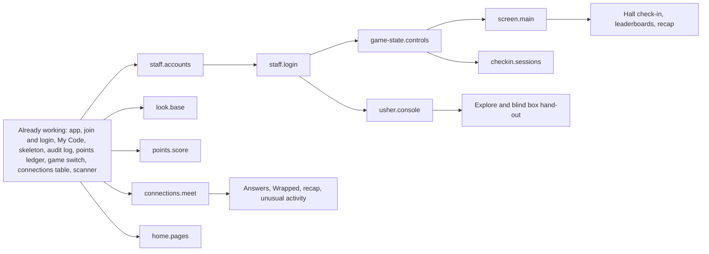

# 16 Feature Tree

- Status: Active
- Owner: Jonathan (@jonathango98)
- Version: 1.7.0
- Last updated: 2026-11-01

> Protected file. Changes go in a PR that Jonathan approves (ENG-080).

Every Planned feature is split into pieces in [feature-tree.yaml](feature-tree.yaml). Each piece says what it builds, which pieces it needs first, and which OPEN rules still lock it. When a piece is finished, the pieces that waited on it unlock. `/pick-task` reads the tree to offer volunteers only pieces that are ready. See it drawn with live status in [docs/feature-tree.md](../docs/feature-tree.md), or interactive at https://jonathango98.github.io/nextgen27-sidequest/.

## 1. Rules

- **ENG-105** [LOCKED] `feature-tree.yaml` is the plan: every piece of planned work, with what it builds (in words a 10-year-old understands), numbered steps to try it by hand once it's built (`try_it`), what it needs, its OPEN blockers, area, size, level, safety review, and rule IDs. Each feature has a `due` Friday from the build weeks in `12-team-timeline.md` (PRD-054). It never holds live status. Status lives in the README Project status (ENG-100), so finishing a piece never needs a foundation change.
- **ENG-106** [LOCKED] Every piece is size S (fits one agent session), M (about two sessions), or L (three to four sessions). Nothing is bigger. If a piece turns out bigger than L, stop and split it in the tree through a PR before building more (DEC-060).
- **ENG-107** [LOCKED] A piece is unlocked when every piece in its `needs` is Working and none of the rules in its `open` list is still in `13-decisions.md` section 3. Working means its ID is in the README Working table or in `already_working` in the tree. Claim only unlocked pieces (AI-003).
- **ENG-108** [LOCKED] Claim and finish one piece at a time, following ENG-101 and ENG-103. The In progress row starts with the piece ID in backticks, for example `` `points.ledger` Points are saved in one place``. The Working table is grouped by area in plain words, and each row lists its finished piece IDs in backticks in its Pieces column (DEC-055). The feature's Planned row stays until its last piece is Working, then it is removed.
- **ENG-109** [LOCKED] Bug fixes, docs, and tooling need no piece. A new feature or piece goes into the tree through a PR before anyone claims it (ENG-080).
- **ENG-110** [LOCKED] `docs/feature-tree.md` is a map of the tree with live status, generated by `python scripts/feature_tree_map.py --write`. A PR that changes the tree, a piece's README row, or the OPEN table regenerates it, and a test fails until it does. On every merge to `main`, the `Feature tree map` workflow publishes the interactive version to GitHub Pages (DEC-039).
- **ENG-111** [LOCKED] Every piece is a slice: if it changes what the server does, the same PR builds the screen that shows the change, so someone can try it on a phone. A server change never waits for a later PR to become visible. Only pieces with nothing to tap (infra, data cleanup, load tests) are tried with a command instead (DEC-060).
- **ENG-112** [LOCKED] Every piece is tried by hand before review. The PR's "How to test" lists the piece's `try_it` steps as a checklist. Before the PR leaves draft, a person (not the agent) runs every step on the PR's Railway preview, on a real phone for player pages, and ticks each one. The browser check (AI-044) still runs before commits. It does not replace the hand test (DEC-060).
- **ENG-113** [LOCKED] PR previews arrive ready to hand-test. When a piece works, the same PR adds fake example data for it to the preview startup in `app/main.py`, next to the Example Churches and the test staff accounts (DEC-064). The seed runs only on `*-pr-<n>` environments (ARCH-017), adds only what is missing, and never changes existing rows. Names are obviously fake (SAFE-031). Passwords and PINs come from Railway variables (ENG-056). Real data and the hidden item list never appear (SAFE-030). Seeding minors' data needs the `safety-review` label (AI-043).

## 2. Core build backbone

Almost every feature waits on these pieces. Player screens can start now. Admin, usher, and main screen pages wait on `staff.login`.

## 3. Features at a glance

The tree is the source. If this table and the tree disagree, the tree wins.

| Feature | Milestone | Due | Pieces | Needs first, from other features | Pieces locked by OPEN rules |
|---|---|---|---|---|---|
| `staff` Staff accounts and roles | Core build | 2026-11-20 | 2 | Working pieces only | None |
| `game-state` Game states and pause | Core build | 2026-12-04 | 3 | `staff.login`, `points.audit-log`, `checkin.sessions` | None |
| `points` Points service | Core build | 2026-11-20 | 3 | `game-state.core` | None |
| `connections` Scanner and connections, with icebreaker | Core build | 2026-12-04 | 5 | `points.ledger` | None |
| `look` Mix look on player screens | January build | 2026-11-27 | 2 | Working pieces only | None |
| `home` Home and Quests pages | January build | 2026-12-11 | 1 | `points.ledger` | None |
| `checkin` Session check-in | January build | 2026-12-11 | 3 | `staff.login`, `points.audit-log`, `game-state.controls`, `screen.main`, `connections.scanner-camera`, `points.ledger` | None |
| `explore` Explore | January build | 2026-12-18 | 2 | `staff.login`, `points.audit-log`, `usher.console`, `points.ledger` | None |
| `journal` Journal and Summary page | January build | 2027-01-08 | 2 | `checkin.sessions`, `points.ledger`, `staff.login`, `points.audit-log` | None |
| `blind-box` Blind boxes (Open Box) | January build | 2026-12-18 | 2 | `usher.console`, `home.pages`, `game-state.core`, `game-state.controls` | None |
| `leaderboards` Leaderboards and church score | January build | 2026-12-18 | 2 | `points.ledger`, `screen.main` | None |
| `usher` Usher console | January build | 2026-12-04 | 1 | `staff.login`, `connections.scanner-camera` | None |
| `admin` Admin console | January build | 2026-12-11 | 4 | `staff.login`, `points.audit-log`, `points.ledger`, `connections.meet` | None |
| `screen` Main screen views | January build | 2027-01-15 | 1 | `staff.login`, `game-state.core`, `game-state.controls` | None |
| `wrapped` Wrapped cards | January build | 2027-01-15 | 4 | `game-state.core`, `staff.login`, `points.audit-log`, `look.base`, `connections.meet`, `journal.notes`, `home.pages`, `connections.answers` | None |
| `recap` Conference recap screen | January build | 2027-01-15 | 1 | `screen.main`, `connections.meet`, `journal.share-review`, `connections.answers` | None |
| `ready` Game day readiness | January build | 2027-01-08 | 5 | `points.audit-log` | None |

## 4. Changing the tree

- Split, merge, add, or reorder pieces in a PR to `feature-tree.yaml`. Keep each piece a slice (ENG-111) and no bigger than L (ENG-106), and update section 3 if a feature's row changes (ENG-087).
- When an OPEN rule is decided (ENG-088), nothing in the tree changes. The pieces it locked unlock on their own once the rule leaves section 3 of `13-decisions.md`.
