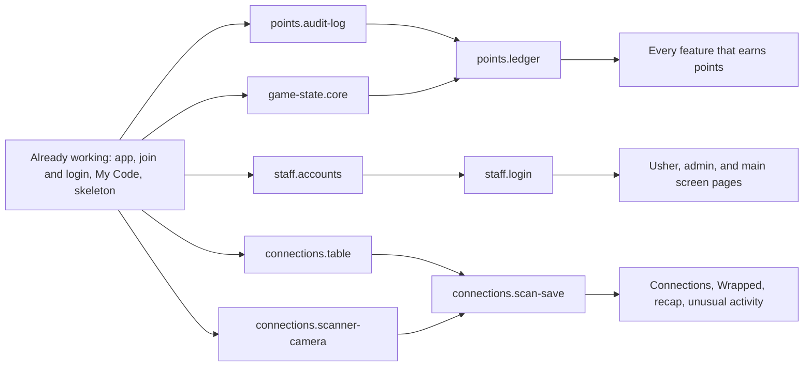

# 16 Feature Tree

- Status: Active
- Owner: Jonathan (@jonathango98)
- Version: 1.2.0
- Last updated: 2026-10-27

> Protected file. Changes go in a PR that Jonathan approves (ENG-080).

Every Planned feature is split into small pieces in [feature-tree.yaml](feature-tree.yaml). Each piece says what it builds, which pieces it needs first, and which OPEN rules still lock it. When a piece is finished, the pieces that waited on it unlock. `/pick-task` reads the tree to offer volunteers only pieces that are ready. See it drawn with live status in [docs/feature-tree.md](../docs/feature-tree.md), or interactive at https://jonathango98.github.io/nextgen27-sidequest/.

## 1. Rules

- **ENG-105** [LOCKED] `feature-tree.yaml` is the plan: every piece of planned work, with what it builds, what it needs, its OPEN blockers, area, size, level, safety review, and rule IDs. It never holds live status. Status lives in the README Project status (ENG-100), so finishing a piece never needs a foundation change.
- **ENG-106** [LOCKED] Every piece is size S (fits one agent session) or M (about two sessions). Nothing is bigger. If a piece turns out bigger than M, stop and split it in the tree through a PR before building more.
- **ENG-107** [LOCKED] A piece is unlocked when every piece in its `needs` is Working and none of the rules in its `open` list is still in `13-decisions.md` section 3. Working means its ID is in the README Working table or in `already_working` in the tree. Claim only unlocked pieces (AI-003).
- **ENG-108** [LOCKED] Claim and finish one piece at a time, following ENG-101 and ENG-103. The In progress row and the Working row each start with the piece ID in backticks, for example `` `points.ledger` Points are saved in one place``. The feature's Planned row stays until its last piece is Working, then it is removed.
- **ENG-109** [LOCKED] Bug fixes, docs, and tooling need no piece. A new feature or piece goes into the tree through a PR before anyone claims it (ENG-080).
- **ENG-110** [LOCKED] `docs/feature-tree.md` is a map of the tree with live status, generated by `python scripts/feature_tree_map.py --write`. A PR that changes the tree, a piece's README row, or the OPEN table regenerates it, and a test fails until it does. On every merge to `main`, the `Feature tree map` workflow publishes the interactive version to GitHub Pages (DEC-039).

## 2. Core build backbone

Almost every feature waits on these pieces. Build them first.

## 3. Features at a glance

The tree is the source. If this table and the tree disagree, the tree wins.

| Feature | Milestone | Pieces | Needs first, from other features | Pieces locked by OPEN rules |
|---|---|---|---|---|
| `staff` Staff accounts and roles | Core build | 4 | `points.audit-log` | None |
| `game-state` Game states and pause | Core build | 4 | `staff.login`, `points.audit-log`, `checkin.sessions` | None |
| `points` Points service | Core build | 4 | `game-state.core` | None |
| `connections` Scanner and connections, with icebreaker | Core build | 8 | `points.ledger` | None |
| `look` Mix look on player screens | January build | 5 | Working pieces only | None |
| `home` Home and Quests pages | January build | 2 | `points.ledger`, `blind-box.math` | None |
| `checkin` Session check-in | January build | 5 | `staff.login`, `points.audit-log`, `game-state.admin-switch`, `screen.shell`, `connections.scanner-camera`, `points.ledger` | None |
| `explore` Explore | January build | 4 | `staff.login`, `points.audit-log`, `usher.scan`, `points.ledger` | None |
| `journal` Journal and Summary page | January build | 6 | `checkin.sessions`, `points.ledger`, `checkin.end-session`, `staff.login`, `points.audit-log` | None |
| `blind-box` Blind boxes (Open Box) | January build | 5 | `points.ledger`, `usher.scan`, `game-state.core`, `game-state.admin-switch` | None |
| `leaderboards` Leaderboards and church score | January build | 3 | `points.ledger`, `screen.shell` | None |
| `usher` Usher console | January build | 2 | `staff.login`, `connections.scanner-camera` | None |
| `admin` Admin console | January build | 6 | `staff.login`, `points.audit-log`, `points.ledger`, `connections.scan-save` | None |
| `screen` Main screen views | January build | 3 | `staff.screen-mode`, `game-state.core`, `journal.review` | None |
| `wrapped` Wrapped cards | January build | 8 | `game-state.core`, `staff.login`, `points.audit-log`, `look.components`, `connections.scan-save`, `connections.icebreaker-answer`, `journal.write`, `blind-box.math` | None |
| `recap` Conference recap screen | January build | 2 | `screen.shell`, `connections.scan-save`, `journal.review`, `connections.icebreaker-answer` | None |
| `ready` Game day readiness | Before Playtest 2 | 5 | `points.audit-log` | None |

## 4. Changing the tree

- Split, add, or reorder pieces in a PR to `feature-tree.yaml`, and update section 3 if a feature's row changes (ENG-087).
- When an OPEN rule is decided (ENG-088), nothing in the tree changes. The pieces it locked unlock on their own once the rule leaves section 3 of `13-decisions.md`.
